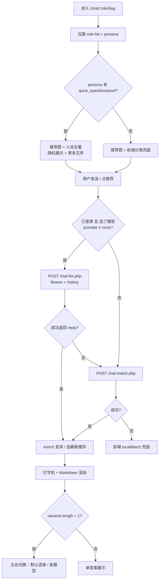
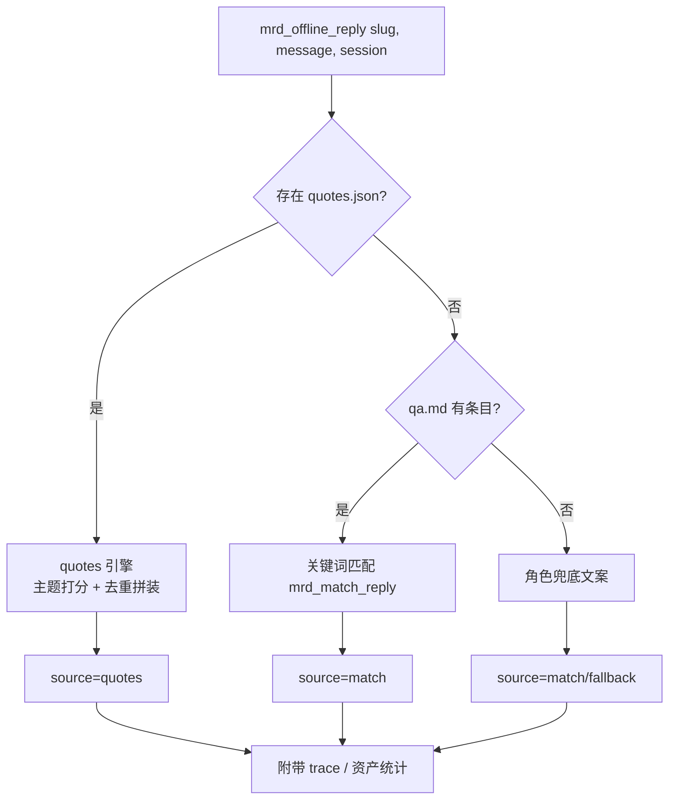
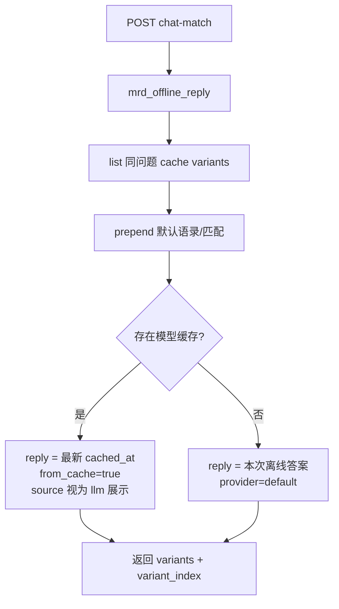
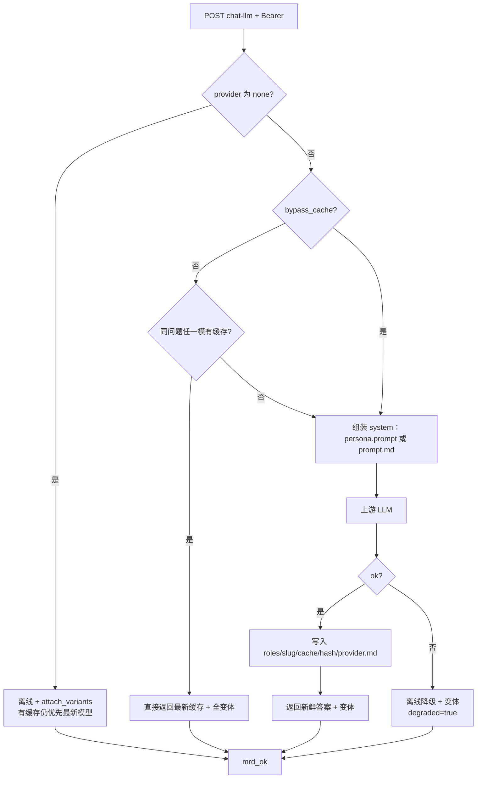
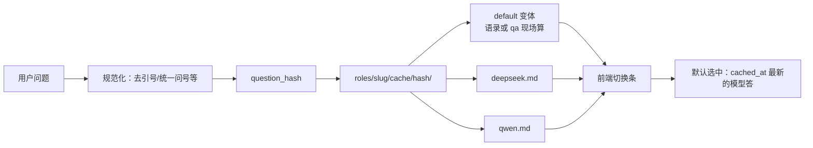

# 03 · 前后端逻辑流程图（含角色差异）

> 配合 [`02-dev-progress.md`](./02-dev-progress.md) 理解「同一套代码、不同角色资产 → 不同体验」。

## 一、角色目录资产模型

```
backend/roles/{slug}/
├── config.md          # 必填：广场卡片元数据
├── prompt.md          # LLM / 无 persona 时的人设
├── qa.md              # 离线关键词库（无 quotes 时主引擎）
├── persona.json       # 可选：system_prompt、推荐题、免责、mode
├── quotes.json        # 可选：语录 mock（存在则优先于 qa）
├── asset/             # 可选：头像等
└── cache/{hash}/      # 可选：问题缓存资产（可入库）
    ├── question.md
    └── {provider}.md
```

| 文件组合 | 离线行为 | 推荐题来源 | 典型品类 |
|----------|----------|------------|----------|
| config + prompt + qa | `qa.md` 匹配 | 前端 `QUICK_BY_CATEGORY` 兜底 | 当前非 yingxue |
| + persona.json | 同上（Prompt 可改走 persona） | persona 全量正序 | 目标态客服/星座/榜样 |
| + quotes.json | **quotes 引擎**，qa 作后备 | persona 或兜底 | 名人戏仿（yingxue） |
| + cache/ | 不改变离线引擎；有缓存则默认展示最新模型答 | — | 任意角色聊过 LLM 后 |

---

## 二、前端总流程



### 前端关键分支说明

1. **未登录 / 未选模型**：只走 `chat-match`；若该问题已有 `cache/`，后端仍可能把 **最新模型缓存** 作为默认展示（可切回默认语录）。  
2. **登录 + 模型**：先 `chat-llm`；失败则降级 `chat-match`，并标 `degraded`。  
3. **推荐「更多」**：始终用配置正序（questions → pool），与芯片区随机展示无关。

---

## 三、后端：离线统一入口



**优先级写死**：`quotes.json` > `qa.md` > 兜底。  
因此：**客服角色不要误放空的 quotes.json**，否则会抢占 FAQ 匹配。

---

## 四、后端：chat-match（游客 / 降级 / 未选模型）



---

## 五、后端：chat-llm（登录选模）



---

## 六、缓存与变体（跨角色相同）



要点：

- 缓存按 **角色隔离**；赢学的 cache 不会串到客服。  
- 无 cache 的角色：variants 通常只有 `default`，不显示切换条。  
- 「默认语录」与「模型缓存」并存，便于对比人设离线 vs 大模型。

---

## 七、按品类的推荐落地路径

```mermaid
flowchart TD
  subgraph 名人戏仿
    Y1[persona + quotes + prompt] --> Y2[离线：语录腔]
    Y2 --> Y3[登录：LLM 戏仿 + 缓存对比]
  end
  subgraph 客服 / FAQ
    S1[persona + 厚 qa.md] --> S2[离线：标准话术命中]
    S2 --> S3[登录：LLM 扩写工单场景]
  end
  subgraph 星座趣味
    A1[persona + qa 运势库] --> A2[离线：关键词运势]
    A2 --> A3[可选 quotes 段子增强]
  end
  subgraph 榜样老师
    T1[persona + 结构化 qa] --> T2[离线：步骤/清单]
    T2 --> T3[登录：LLM 深拆解]
  end
```



| 品类 | 最小可演示 | 推荐完整态 | 勿做 |
|------|------------|------------|------|
| 名人戏仿 | quotes + persona | + cache 黄金题 | 空 quotes 占位 |
| 客服 | 厚 qa | + persona 推荐题 | 强行 quotes 抢 FAQ |
| 星座 | 厚 qa | + persona；可选 quotes | 伪科学承诺 |
| 榜样/老师 | 厚 qa | + persona；LLM 缓存精品答 | 伪装专业资质 |

---

## 八、联调检查清单（换角色时）

1. 广场能扫到 `config.md`，头像色/分类正确。  
2. 游客提问：看 debug `engine` 是 `quotes` 还是 `qa_md`。  
3. 打开「更多」：有 persona 则正序全量；否则确认分类兜底可接受。  
4. 登录选模型问同一句两次：第二次应 `from_cache`，切换条含默认 + 模型。  
5. 换另一个 slug 重复 2～4，确认 cache 目录隔离。

改降级顺序、缓存策略或推荐题来源时：**先更新本图，再改代码**，避免角色差异口头约定丢失。
